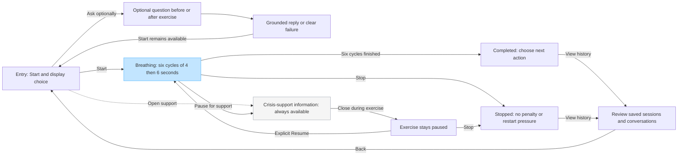

# Paced-breathing experience — Part One proposal

Selected skill: paced breathing (4–6), October 15, 2026. This is a design artifact,
not a running interface. See [design rationale and behavior](design-pipeline.md).

[Open the editable FigJam flow](https://www.figma.com/board/5Yv6ahXxwccAIgLu7nM0HV).
Generated through Figma MCP; no running Vue application was captured. Instructor
access to the board is not confirmed, so the complete flow is also included here.

## Main flow



Support is visible on every view, including result/history/error states; repeated
arrows are omitted. Outside exercise, closing support returns to the previous
view, not a paused exercise. Stop remains available inside support. Results also
offer entry without history. A failed save shows Not saved and explicit Retry save.

## Low-detail screen sketches

These sketches propose content hierarchy. Later Vue/Figma work can refine layout
after checks. All content is fictional.

### Entry — selected proposal

```text
Mental Health Skills App          [Crisis-support information]
Coursework prototype · fictional testing only

Paced breathing
Inhale for 4 seconds. Exhale for 6. About 60 seconds.

[ Start breathing ]
You can stop at any time.

Display: Text cues  [Change]
[What happens?]  [Optional questions]  [History]
```

Alternative: put a longer introduction/chat above Start. More context, but more
reading and a possible model gatekeeper. The selected proposal emphasizes action
and makes explanation optional (D3/R4).

### Exercise — representative first inhale

```text
Coursework prototype              [Crisis-support information]

                        Inhale
                           4
                     Cycle 1 of 6

                         [ Stop ]
```

Four seconds later replace the instruction/count with Exhale / 6. Optional ring
motion follows the same clock; reduced-motion uses stationary text/countdown.
No chat arrives on this view. This static sketch does not prove timing.

### Support opened during exercise

```text
Crisis-support information
Exercise paused. You can stop at any time.

[Region clearly labeled]
[Verified resource name, contact method and destination]
Resource content to be verified before implementation.

[ Stop exercise ]                         [ Close support ]
```

Close returns to a paused view with explicit Resume / Stop. No automatic resume.
This is a design placeholder, not a usable resource page.

### Result and history

```text
Exercise stopped                  [Crisis-support information]
Session saved / Saving / Not saved (show actual state)
[ View history ]  [ Back to entry ]  [ Retry save if needed ]

History
Sessions: time | paced breathing | active seconds | outcome
Conversations: ordered submitted messages and actual replies
Empty or failed history is labeled. No invented records or health scores.
```
